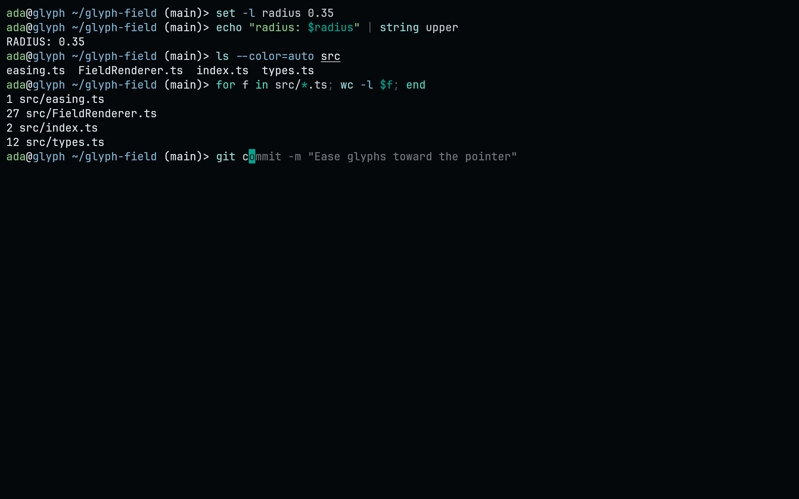
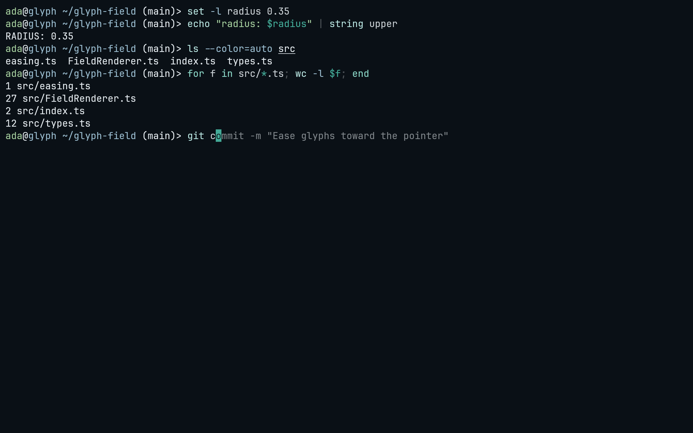
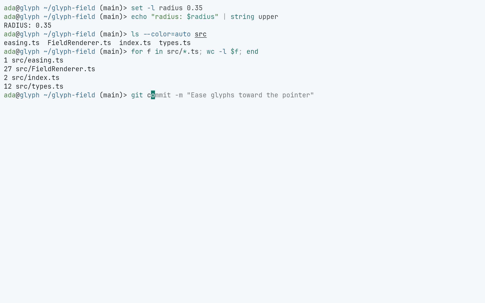
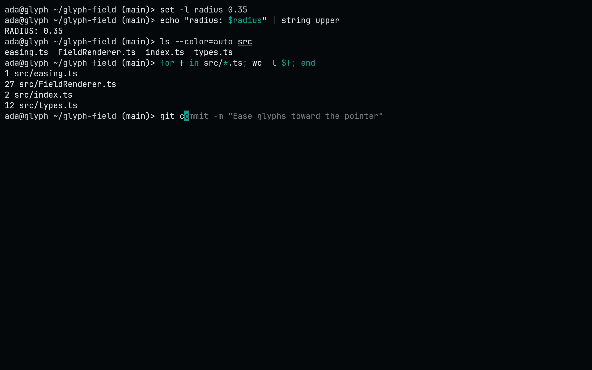

<!-- living-code-readme:1 -->
# 🐟 Living Code for fish

**Calm slate. Living color.** Living Code for fish. Repository-owned theme files, installation instructions and four color flavors.

[Installation](#installation) · [Flavors](#flavors) · [Configuration](#configuration) · [All ports](https://github.com/living-code-theme)

## Previews

<table data-lc-flavors>
<tr>
<td width="50%" valign="top">
<strong>Night</strong><br><sub>Dark · full palette</sub><br><br>
<a href="images/night.png"></a>
</td>
<td width="50%" valign="top">
<strong>Frost</strong><br><sub>Dark · softer chroma</sub><br><br>
<a href="images/frost.png"></a>
</td>
</tr>
<tr>
<td width="50%" valign="top">
<strong>Paper</strong><br><sub>Light · near-white slate</sub><br><br>
<a href="images/paper.png"></a>
</td>
<td width="50%" valign="top">
<strong>Signal</strong><br><sub>Dark · teal accent</sub><br><br>
<a href="images/signal.png"></a>
</td>
</tr>
</table>

Select any preview to view the image at full size.

## Installation

Needs fish 3.4 or newer. Download the themes, then choose one:

```fish
curl -fsSL --create-dirs --output-dir ~/.config/fish/themes -O "https://raw.githubusercontent.com/living-code-theme/fish/main/living-code-{night,frost,paper,signal}.theme"
echo 'fish_config theme choose living-code-night' >> ~/.config/fish/config.fish
```

Run `fish_config theme choose living-code-night` on its own to try a flavor in the current session; the `config.fish` line makes it stick. `fish_config theme save living-code-night` also works but asks for confirmation. `fish_config theme list` shows the other flavors.

## Flavors

Expand a flavor for its full-size preview and activation instructions.

<details data-lc-flavor="night">
<summary><strong>Night</strong> · Dark · full palette</summary>

<p><a href="images/night.png"></a></p>

```fish
fish_config theme choose living-code-night
```

</details>

<details data-lc-flavor="frost">
<summary><strong>Frost</strong> · Dark · softer chroma</summary>

<p><a href="images/frost.png"></a></p>

```fish
fish_config theme choose living-code-frost
```

</details>

<details data-lc-flavor="paper">
<summary><strong>Paper</strong> · Light · near-white slate</summary>

<p><a href="images/paper.png"></a></p>

```fish
fish_config theme choose living-code-paper
```

</details>

<details data-lc-flavor="signal">
<summary><strong>Signal</strong> · Dark · teal accent</summary>

<p><a href="images/signal.png"></a></p>

```fish
fish_config theme choose living-code-signal
```

</details>

## Configuration

See [fish's documentation](https://fishshell.com) for application settings and reload behavior. The activation instructions above identify each supported flavor; keep your other application configuration.

## Compatibility

Requires fish 3.4 or newer. The committed files use fish's native .theme format.

## Contributing

Found a problem? [Open an issue](https://github.com/living-code-theme/fish/issues/new/choose) with the app version, the flavor and a screenshot. Want Living Code somewhere else? [Request a port](https://github.com/living-code-theme/core/issues/new?template=port-request.yml).

Pull requests are welcome. Keep this README, `port.json` and `images/` in sync, and use real screenshots of the app, never mockups.

🦎 **One chameleon, many habitats.** Part of [Living Code](https://github.com/living-code-theme).

## License

[MIT](LICENSE) © Elliot Luque
